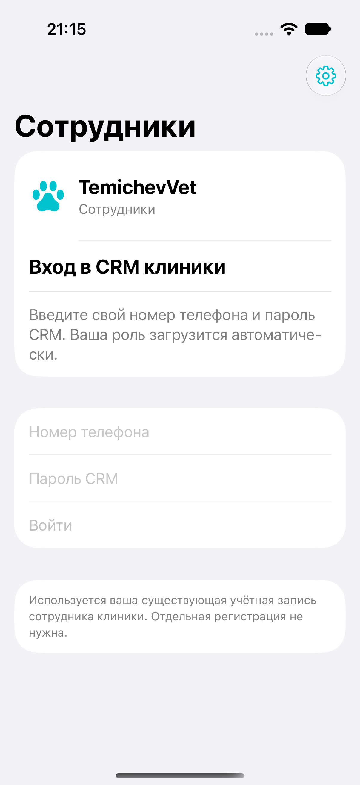

# Исправленный вход в приложение сотрудников

После снимка с непонятным экраном «Доверенный телефон» вход переделан по прямому запросу пользователя. В версии **0.1.0 (2)** главный экран содержит номер телефона и пароль CRM. Адрес клиники уже настроен; код/ссылка приглашения и отдельная регистрация удалены из интерфейса. Роль автоматически загружается из существующей учётной записи. В профиле явно показаны «Директор», «Врач» или «Грумер».

Для директора используется именно его учётная запись сотрудника CRM. Если телефон в ней не задан, его надо привязать к этой существующей записи; приложение не создаёт второго директора или аккаунта владельца питомца. Настоящий профиль/пароль пользователя в этой работе не читались и не изменялись.

## Готовность

- **Исправленная сборка:** локальный App Store distribution archive 0.1.0 (2) подготовлен и проверен, в TestFlight пока не загружен. [Квитанция](password-login-signed-archive.json). В TestFlight остаётся ранее выданная 0.1.0 (1).
- **Серверный пакет:** `Artifacts/StaffServer-password-login-20261028.tar.gz`, 99 файлов включая manifest. Исходная разница с актуальной CRM — 32 файла API/схемы. Пакет не развёрнут; рабочая CRM и роли не менялись. [Hash пакета](password-login-server-packet.json), [контракт и план активации/отката](../ServerAdapter/password-login/README.md).
- **Рабочее соединение:** штатный системный curl с включённой проверкой сертификатов получил `release.json` 200 с ревизией `4db748e0`, `auth/me` 401 и `v1/staff-app/me` 404. API приложения сотрудников ещё отсутствует. Первоначальная ошибка Python связана с его локальным CA store; она не означала неисправность рабочего HTTPS. [Точная запись](password-login-live-status.json).
- **Реальный iPhone:** снимок пользователя подтверждает запуск старого приложения; успешный вход в рабочую CRM новой версией ещё не принят. Новый подписанный архив и локальная синтетическая проверка этого не заменяют.

Серверный кандидат сохраняет последний опубликованный груминг, включая MAX «было / стало» и актуальное окончание. Существующие роли, касса/склад, рабочие ограничения и врачебные права не расширяются. После правильного пароля сервер автоматически регистрирует телефон; отзывать известную установку по-прежнему можно. Очистка данных входа не сбрасывает идентификатор установки и не снимает её отзыв. Серверный секрет остаётся на сервере.

## Проверки

**27 HTTP-наборов** пройдены на актуальном объединённом серверном кандидате: 16 прежних сценариев расписания/груминга/чатов/прав и 11 нового входа. Проверены ошибочный пароль без регистрации телефона, нормализация номера, существующая роль директора, повтор без дубля устройства, запреты приложения/аккаунта/политики, отзыв и ограничение попыток. Новых пользователей, сотрудников и приглашений новый вход не создаёт. Старый веб-вход остаётся прежним. [Основной HTTP](http-acceptance.json), [вход](password-login-http.json).

**22 выбранных XCTest-проверки** имеют успешный последний результат: 18 unit/security/push и 4 нативных сценария — врач/сохранение входа, offline/expiry, телефон/отзыв и директор. Это агрегат нескольких записанных прогонов; исходные ошибки и исправления перечислены в [verification](password-login-verification.json). Последний сценарий отзыва проверяет автоматический выход открытого приложения. Данные только вымышленные в собственной схеме `staff_ios_qa_20261028`; helper после проверки остановлен.

Проверка datamodel подтвердила сохранность прежних полей/перечислений CRM и только шесть новых staff-таблиц/nullable ключ сообщения. SQL исключительно добавочный. [Квитанция совместимости](password-login-model-compatibility.json). Роли не мигрируются. Этот локальный контроль не заменяет свежую резервную копию и квалификацию восстановленной рабочей БД перед активацией.

## Следующая операция

Для входа на телефоне сначала нужен отдельный выпуск общего API на текущую рабочую CRM, со свежей проверенной копией, сохранением защищённых сервисов и откатом только API. Затем следует выдать соответствующий build 2 через TestFlight и принять вход директора на настоящем iPhone. Серверная доставка APNs остаётся отдельной неподтверждённой функцией; отсутствие её настройки честно показывается приложением.

Другое приложение TemichevVet и PWA-кабинет владельцев этой правкой не изменяются. Публичная App Store-подача не выполнялась.
