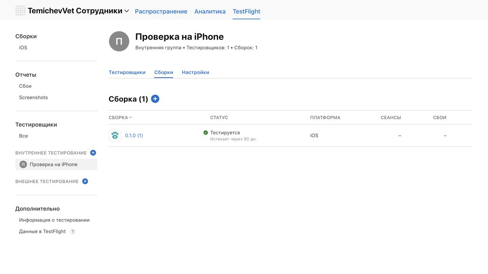

# Первая TestFlight-сборка CRM для сотрудников

Последующее исправление: пользователь открыл build 1 на iPhone и показал непонятный экран приглашения. В [кандидате build 2](PASSWORD-LOGIN.md) вход заменён на номер/пароль CRM. Кандидат подписан локально, ещё не загружен/выдан; серверный API пока не развёрнут. Текст ниже фиксирует состояние первоначального выпуска.

28 октября 2026 владелец прямо разрешил подготовить и загрузить первую версию для тестирования через TestFlight. Уточнённая область: отдельное CRM-приложение только для сотрудников — врачей и грумеров. Для владельцев клиники остаётся PWA-кабинет; другое приложение TemichevVet этой работой не меняется.

Создана отдельная карточка **TemichevVet Сотрудники**, App ID `ru.temichevvet.staff`, App Store Connect app `6828072957`. Первая версия — **0.1.0 (1)**. Подписанный архив проверен: правильный bundle ID и номер, действующая distribution-подпись, `get-task-allow=false`, production APNs entitlement, стандартное шифрование с `ITSAppUsesNonExemptEncryption=false`, без ATS-исключений.

**Итог: Apple завершила обработку; сборка имеет статус «Тестируется» во внутренней группе «Проверка на iPhone» (1 тестировщик, 1 сборка).** Назначение группы и точный русский текст проверены после перезагрузки. Тестировщик отображается как приглашённый; получение письма и установка на телефон ещё не подтверждены.

Загрузка подтверждена всеми маркерами `Uploaded package is processing`, `Upload succeeded` и `EXPORT SUCCEEDED`. В App Store Connect бинарный файл отмечен «Подтвержден», bundle ID и версия совпадают. Итог обработки/назначения группы сохранён в [квитанции](testflight-signed-archive.json).

Подготовлена внутренняя группа **«Проверка на iPhone»** с существующим Apple-аккаунтом владельца. Автоматическое распределение будущих сборок выключено; эта задача касается первой версии. Новые пользователи App Store Connect не создавались. Публичная App Store-подача не выполнялась.

Использован workflow `codex-ios-api-build`. Действующего локального `.p8` API-ключа нет, поэтому загрузка выполнена существующей сессией Xcode и явным App Store distribution profile. Начальная автоматическая попытка archive запросила development devices; вместо добавления UDID выбран профиль App Store для этого конкретного приложения. Новые сертификаты и приватные ключи не создавались.

Подпись, provisioning profile, archive/export и distribution-логи находятся в защищённых локальных/игнорируемых файлах. Операционные Team/Certificate/Profile ID, ключи, IPA и логи в Git не включаются. Канонический генератор проекта сохраняет декларацию стандартного шифрования; Team и signing profile в исходники не зашиты.

## Граница тестирования

Общий staff/chat API пока локальный и этим выпуском не развёрнут. До его подключения на телефоне принимаются установка, запуск, настройка HTTPS-адреса и нативный интерфейс. Вход в рабочие экраны, расписание, запись и оба чата на телефоне потребуют согласованной серверной интеграции. Существующие локальные 16 HTTP-наборов и 25 XCTest-сценариев не выдаются за эту проверку.

APNs entitlement и клиентская регистрация подготовлены; серверная доставка не настроена и физическое оповещение ещё не принято. Установка на настоящий iPhone, получение приглашения и реальный Android ↔ iPhone обмен здесь не подтверждаются.

Русские [инструкции](TESTFLIGHT-WHAT-TO-TEST-ru.txt) опубликованы и проверены после перезагрузки. Английский [черновик](TESTFLIGHT-WHAT-TO-TEST-en-US.txt) подготовлен локально; в карточке сейчас основной русский язык. Инструкции прямо указывают границу неразвёрнутого API и APNs.
