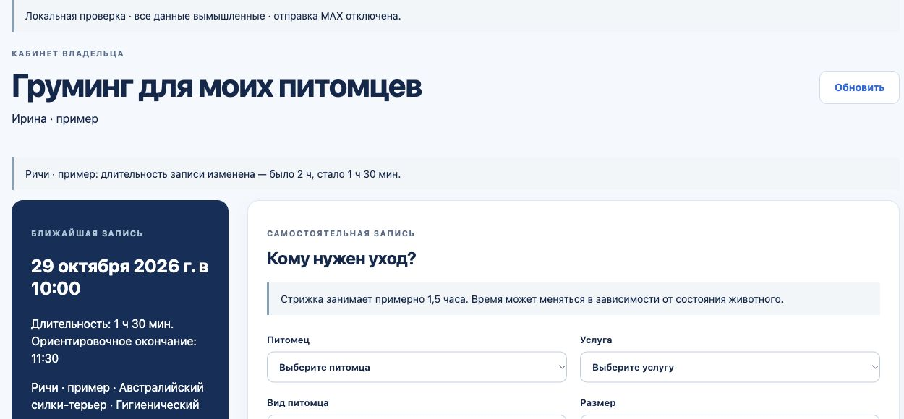

# Клиенту видно изменение длительности — выложено

Поправка `crm-grooming-owner-duration-20261028-r1`, код `4db748e0236b4b294bca8171550f3cefed49a8db`, выложена в рабочие API CRM и клиентскую страницу груминга. Сервисы и публичный HTTPS проверены. В CRM Web изменён только маркер версии; схема базы и остальные страницы кабинета не менялись.

## Что получает клиент

- После изменения длительности грумером или администратором создаётся MAX-уведомление: было / стало, прежнее начало и новое ориентировочное окончание. Пример: «было 1 ч 30 мин, стало 2 ч».
- В существующей записи отображаются актуальная длительность и ориентировочное окончание. В открытом клиентском кабинете обновляются только эти данные, без перезагрузки страницы и без потери введённых пожеланий.
- Первичный выбор свободного времени на сайте сохраняет только начало и общую оценку 1,5 часа. Цена, владелец, питомец, грумер и место не меняются при уточнении длительности.
- Согласия клиента, тихие часы, повторная доставка с прежним ID и защита от дублей сохранены. Повтор той же команды и неизменённая длительность не создают второе сообщение.

## Проверено

Локально прошли календарные сценарии, проверки публичных мест/занятости, реальный HTTP API → gateway → локальный HTTP MAX, потеря подтверждения доставки, отказ клиента от уведомлений и пять проверок UI. Физическая доставка в настоящий MAX в этом запуске не проверялась; реальным клиентам тестовых сообщений не отправляли.

В реальном браузере отдельной локальной CRM вымышленная запись изменена с 2 часов до 1 часа30мин. Открытая страница показала изменение и окончание11:30 при прежнем начале10:00; введённые пожелания сохранились. Фрагмент ниже содержит вымышленные данные.

Перед переключением на каждом сервере создана свежая приватная копия. Копия CRM восстановлена без внешней сети; проверены создание записи, уточнение длительности, уведомление клиенту, права, конфликты, сохранность начала/цены и совместимость прежнего API. Контроль защищённых таблиц после удаления тестовых данных прошёл. Копия кабинета также восстановлена и квалифицирована.

После переключения подтверждены: API/database `ok`, новые образы и публичный скрипт соответствуют пакету; четыре защищённых сервиса CRM и два сервиса кабинета сохранились. Настройки MAX и флаг клиентских уведомлений сохранены включёнными. Число записей и настроек груминга прежнее: 2 профиля, 2 места, 218 услуг, 0 правил, 0 смен, 0 бронирований; публичный каталог172услуги. Тестовых данных в рабочую базу не добавляли.

## Откат и подтверждения

[ROLLBACK.md](ROLLBACK.md) содержит команды возврата к предыдущей версии365 с сохранением новых рабочих данных. Приватные копии, предыдущие образы и операторы отката сохранены на серверах. Подтверждения: `deployment-receipt.json`, `verified-clinic.json`, `verified-gateway.json`, `qualification-clinic.json`, `proof-gateway.json`, `public-proof.json`, `packet-summary.json`.

Чатам приложений и PWA передано уточнение: использовать актуальные startsAt/endsAt существующей записи, показывать длительность/ориентировочное окончание и обновлять карточку при возвращении из MAX. Нативные приложения этой выкладкой не публиковались.

## Очистка

Удалены только сверенные временные архивы этой поправки, вспомогательный локальный фрагмент сборки и три завершённые задачи её запуска. Резервные копии, текущие и предыдущие образы, исходники, доказательства проверки и активная локальная копия сохранены. Подтверждение — `cleanup-summary.json`.
